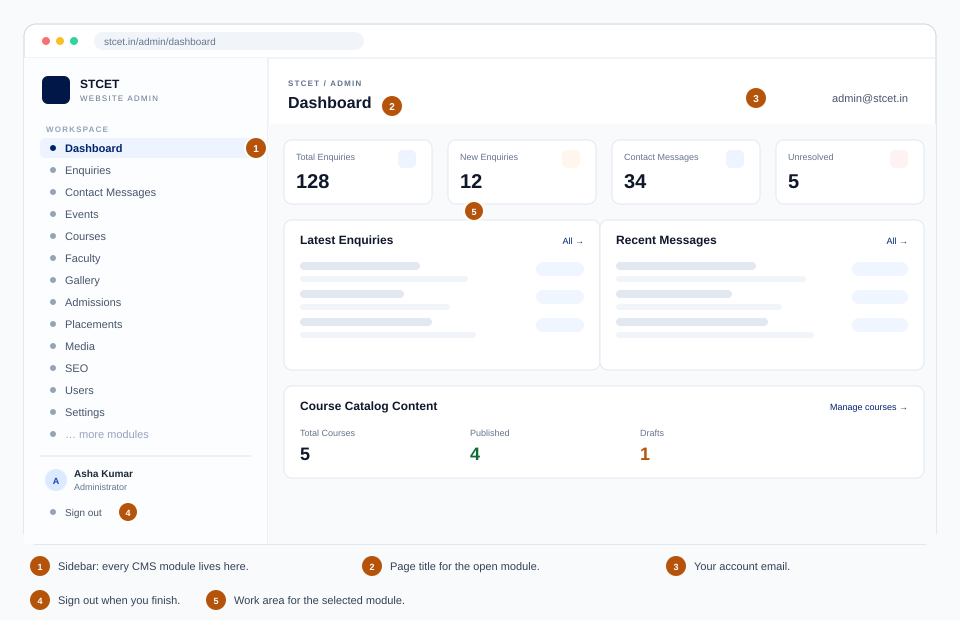
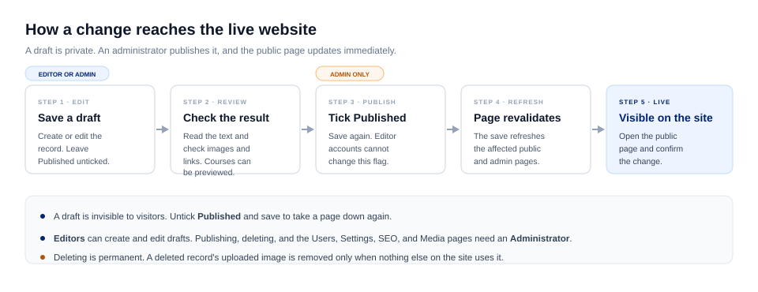
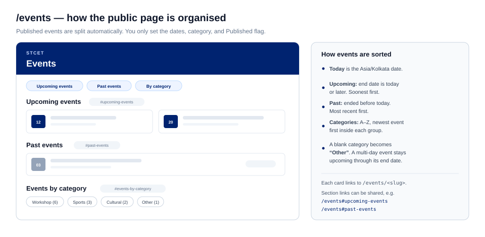
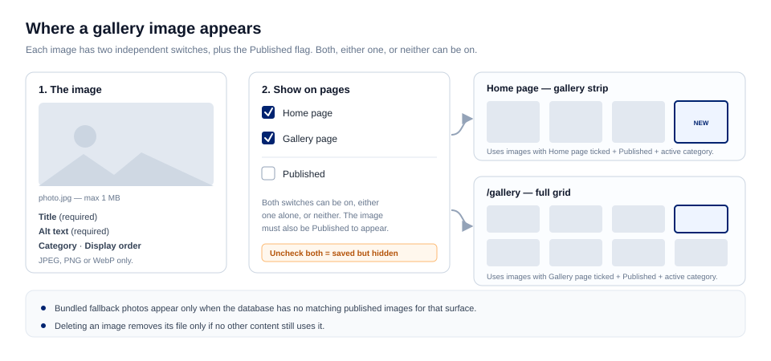
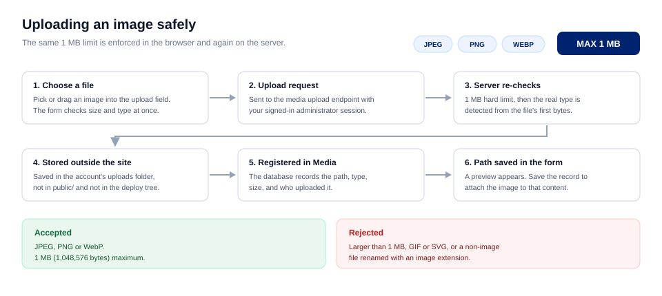

# STCET Admin User Guide

This guide is for college staff who update the STCET website through the admin
area. It explains how to sign in, find your way around, publish content safely,
and solve the problems staff run into most often. No coding knowledge is needed.

The screens you use are described with labelled diagrams. The diagrams show the
real module names, field names, and page structure from the current admin.

> This guide covers the **admin area** only. For installation, database, and
> deployment details, see the [developer documentation](./README.md), especially
> [admin-cms.md](./admin-cms.md).

---

## Who this guide is for

There are two kinds of admin account:

- **Editor** - creates and edits website content.
- **Administrator** - does everything an editor can do, and also publishes,
  deletes, manages users, and changes site-wide settings.

Throughout this guide, "you" means either role. Anything marked
**Administrator only** needs an administrator account.

## Before you start

- **Admin address:** open `https://stcet.in/admin/login` in your browser and
  bookmark it. Locally this is `http://localhost:3000/admin/login`.
- **Account:** an administrator creates your account. There is no sign-up form.
- **Browser:** use a current version of Chrome, Edge, Firefox, or Safari. A
  desktop or laptop is best for editing. The admin works on a phone, but wide
  tables and rich-text fields are easier on a larger screen.
- **One account per person:** never share a login. Every change is recorded
  against the signed-in account.
- **Saving is live:** when you save a published record, the public page updates
  immediately. There is no separate "go live" step after saving.

## Signing in

1. Go to the admin address. You will see the **Sign in to your account** page.
2. Enter your **Email address** and **Password**.
3. Select **Sign in**.
4. You land on the **Dashboard**.

The page also shows "Restricted to authorized college staff". The admin is not
linked from the public site and is hidden from search engines.

**Lockout:** after five failed attempts in 15 minutes, sign-in is blocked for
15 minutes. Wait for the block to pass, then try again with the correct
password. Do not keep retrying.

**Sessions are time-limited.** If you are returned to the sign-in page, sign in
again. Anything you had typed but not saved is lost.

**Sign out** from the bottom of the sidebar, especially on a shared computer.

## If you forget your password

1. On the sign-in page, select **Forgot your password?**
2. Enter your registered email address.
3. Select **Send reset link**.
4. Open the email and select **Reset Password** (or copy the link).
5. Enter a **New password** and **Confirm new password**, then select
   **Reset password**.
6. Sign in with the new password.

Important details:

- The page always says "If an account exists for this email address, a password
  reset link has been sent." This is deliberate: it stops strangers from
  discovering which email addresses have admin accounts.
- The reset link is **single-use** and expires after **60 minutes**.
- You can request one reset email every **15 minutes**. Asking again sooner does
  not send a second email.
- Requesting a new link invalidates older unused links.
- The new password must be at least **8 characters**. Use a longer passphrase
  (12+ characters, mixed words) and never reuse another password.
- Check your spam or quarantine folder. Ask your administrator to allow mail
  from the college's ZeptoMail sender.
- If you see "Password reset email is not configured. Please contact an
  administrator.", email is not set up on the site. Ask an administrator to
  check the ZeptoMail settings, or ask the developer to reset the account on the
  server.

Administrators cannot view or type a new password for an existing user on the
**Users** page. The reset email is the normal way to regain access.

---

## Tour of the admin

*Figure 1 - The admin has a fixed sidebar (1), a page title (2), your account
email (3), the **Sign out** button (4), and a work area that changes with the
selected module (5).*

- **Sidebar (left):** every content module. The current module is highlighted.
  On a phone, use the menu button in the top bar to open it.
- **Top bar:** shows `STCET / Admin`, the current module name, and your email.
- **Account block:** your name and role, and **Sign out**.
- **Work area:** lists, forms, and tables for the selected module.

The sidebar order is: Dashboard, Enquiries, Contact Messages, Events, About,
Governing Council, Courses, Faculty, Faculty Groups, Gallery, Admissions,
Scholarships, Placements, Infrastructure, Committees, Media, SEO, Users,
Settings, Menus, Institutional Pages.

The sidebar shows all modules to everyone, but **Users**, **Settings**, **SEO**,
and **Media** are administrator-only. If an editor opens one of them, the admin
returns them to the Dashboard.

### Dashboard

The Dashboard is the home screen:

- **Total Enquiries** - every admission enquiry received.
- **New Enquiries** - enquiries not reviewed yet.
- **Total Contact Messages** - messages from the public contact form.
- **Unresolved Submissions** - enquiries and messages still awaiting resolution.
- **Latest Enquiries** and **Recent Messages** - the newest items with status
  badges and quick links.
- **Course Catalog Content** - total, published, and draft course counts.

The four summary cards are clickable and take you to the matching filtered list.
If the page says **Dashboard data unavailable**, the website cannot reach its
database. Tell your developer; content pages may still show their last saved
state.

---

## Roles and permissions

| Task | Editor | Administrator |
| --- | --- | --- |
| View dashboard, enquiries, contact messages | Yes | Yes |
| Create and edit drafts in content modules | Yes | Yes |
| Publish or unpublish content | No | Yes |
| Delete content records, gallery categories, and images | No | Yes |
| Add and edit gallery images | Yes (saved as a draft) | Yes |
| Add and edit faculty | Yes | Yes |
| Bulk publish, unpublish, or delete faculty | No | Yes |
| Edit a course that is already published | No | Yes |
| Users, Settings, SEO, Media | No | Yes |
| Create and edit draft menu items | Yes | Yes |
| Edit published menu items | No | Yes |
| Delete enquiries and contact messages | Yes | Yes |

**Why the difference?** Editors prepare content; administrators approve it.
This keeps a half-finished draft from appearing on the public site.

If the **Published** checkbox is missing or disabled, you are signed in as an
editor. Ask an administrator to publish the record. You can still save your
work as a draft.

---

## Drafts, publishing, and deleting

*Figure 2 - A draft is private. An administrator ticks **Published** and saves;
the public page refreshes immediately.*

Most content records share the same lifecycle:

1. **Create or edit** the record.
2. **Review** the text, images, links, dates, and order.
3. **Publish** (administrator): tick **Published** and select **Save** again.
4. **Refresh** the public page to confirm.

Rules that apply everywhere:

- **Unticked Published = draft.** Visitors cannot see a draft, and search
  engines cannot index it.
- **Saving is not publishing.** If you change a published record, keep
  **Published** ticked when you save, or it becomes a draft.
- **To take something down,** untick **Published** and save. Do not delete it
  unless you are sure it should be gone permanently.
- **Deleting is permanent.** Deletions cannot be undone from the admin. The
  confirmation dialog exists for a reason; read it before confirming.
- **Images are shared.** Deleting a record removes its uploaded image file only
  when no other content still uses that image. Deleting a company logo or a
  portrait therefore does not break a photo used elsewhere.
- **The wording varies slightly by module:** "Published", "Published on the
  public website", or "Published on the public faculty page". They mean the same
  thing.

Administrators can reverse a deletion only from a database backup. Treat
**Delete** as final.

---

## Enquiries

**Enquiries** holds submissions from the public **Enquire Now** page. This is
personal data: handle it with care and do not export or share it unnecessarily.

### Find an enquiry

- **Search** by student name, mobile number, email address, or enquiry number.
- Filter by **Status**, by **Course**, and by a **date range**.
- Sort **Newest First** or **Oldest First**.
- Select **CSV** to download the currently filtered records. The export respects
  your search, status, course, and date filters.

### Open and action an enquiry

Select an enquiry to open its full record. The detail view has five parts:

1. **Student Information** - name, date of birth, community/category, mobile,
   email, hostel and transport requirements.
2. **Parent / Guardian Details**.
3. **Academic Details**.
4. **Course Preferences & Source** - what the student is interested in and how
   they heard about the college.
5. **Internal Admin Notes** - private notes for staff and admission counsellors.
   These notes are never shown to the public.

At the top of the record you can change the **Status** immediately. The five
statuses mean:

| Status | Use it when |
| --- | --- |
| **New** | The enquiry has not been reviewed yet. |
| **In Progress** | Someone is following up. |
| **Contacted** | The student or parent has been contacted. |
| **Resolved** | The enquiry is finished. |
| **Spam** | The record is junk or a test. |

Select **Save notes** after typing notes. Notes save separately from the status.

**Delete Submission** is permanent. Use it only for spam, duplicates, or test
records - not for genuine enquiries you have finished with. A resolved enquiry
is a useful record; keep it.

### Email notifications

When ZeptoMail is configured, the admin notification address receives an email
for each enquiry, and the student receives a confirmation. The submission is
saved **before** email is sent, so a mail failure does not lose the enquiry. If
a student says they did not receive a confirmation, check the record here first.
See [Email notifications](#email-notifications).

---

## Contact messages

**Contact Messages** holds messages from the public **Contact** page. The
workflow matches Enquiries:

- Search, filter by status, and download a CSV of the filtered results.
- Open a message to read the full text and see the sender's name, email, and
  phone number.
- Change the **Status** and keep internal **Admin Notes**.
- Delete a message only when it is spam or a test.

Use the same five statuses. Reply to the visitor from your normal college email
account; the admin does not send replies from this screen.

---

## Events

**Events** feeds the public `/events` page and each event detail page. Staff
only set the title, dates, category, and **Published** flag; the public page
sorts everything automatically.

*Figure 3 - Published events are grouped automatically. Each section has a
shareable link: `/events#upcoming-events`, `/events#past-events`, and
`/events#events-by-category`.*

### Add or edit an event

Select **Add event** (or open an existing event) and fill in:

- **Title** (required)
- **Category** (optional) - free text, for example `Workshop`, `Cultural`,
  `Sports`. Leave it blank and the event is grouped under **Other**.
- **Start date** (required) and **End date** (optional) - use the end date for
  multi-day events.
- **All-day event** - tick this to hide the time fields.
- **Start time** and **End time** (optional).
- **Venue** (optional) and **Location details** (optional).
- **Short description** (optional, up to 500 characters) - used in listings.
- **Full description** (optional) - the event detail page body.
- **Registration URL** and **Website URL** (optional).
- **Cover image** (optional) and **Image alt text**.
- **Featured event** - adds a star marker in the admin list. It does not change
  the public grouping.
- **Published** (administrator only).

Then select **Save** (or **Save changes**).

### How the public page sorts events

- **Today** means today's date in **Asia/Kolkata**.
- **Upcoming events:** the event's end date (or start date if there is no end
  date) is today or later. Soonest first.
- **Past events:** the event ended before today. Most recent first.
- An event that started yesterday and ends tomorrow is still **upcoming**.
- **Events by category:** categories A-Z, newest event first inside each group.
- Each card links to `/events/<slug>`.

The URL slug is generated from the title when the event is created. Changing the
title later does **not** change the existing link, so shared links keep working.

**Order in the admin list:** the up and down arrows change the manual order.
**Delete** asks for confirmation and is permanent (administrator only).

If an event is not where you expect, check the **end date** first. An event
dated in the past belongs in **Past events**, even if it is still published.

---

## Courses

**Courses** manages the course catalog and the five detailed course pages. The
list has a search box and a status filter (All, Published, Draft).

- Select **New course** to create a course.
- Select **Edit** to change an existing course.
- **Preview** shows the course page before it is public.
- **View public page** appears for published courses and opens `/courses/<slug>`.

The course editor is long. Its sections are:

1. **Overview** - course name, slug, degree, tagline, hero image, description,
   and the **Published** checkbox.
2. **Section headings & intros** - headings and intro copy for each part of the
   public page. Empty fields fall back to the bundled course content, so you can
   change only what you need.
3. **Curriculum slides** - number, title, description, and module image, in the
   order shown.
4. **Opportunity areas** - the opportunity list.
5. **Why study** content.
6. **Career pathways** - number, title, image, and career roles.
7. **Additional future-facing pathways**.
8. **SEO** - SEO title, meta description, canonical URL, Open Graph image, and
   no-index.

Use the **Add item**, **Move up**, **Move down**, and **Remove** controls inside
each list to build the page.

**Slug:** the slug is the public URL, for example `/courses/computer-science`.
It must be unique. Changing it on a published course breaks old links; change it
only when necessary.

**Editors cannot edit a course that is already published.** The page explains
this and asks an administrator to unpublish it first. This prevents accidental
changes to a live course page.

**Deleting a course** also deletes its curriculum slides, opportunities,
reasons, pathways, and other nested content. Only an administrator can delete a
course. The confirmation dialog names the course.

---

## Gallery

**Gallery** has two parts: categories and images. Categories organise the public
`/gallery` page and the home-page gallery strip.

*Figure 4 - **Home page** and **Gallery page** are independent. Tick one, both,
or neither. The image must also be **Published** and in an **Active** category.*

### Categories (administrator only)

At the top of the module, add a category with:

- **New category** - the display name.
- **Slug** - lowercase letters, numbers, and hyphens, for example
  `campus-life`.
- **Order** - smaller numbers appear first.
- **Active** - untick to hide the whole category and its images from the public
  gallery.

Select **Add**. Existing categories can be edited or deleted. A category that
still has images should be emptied first, or the images moved to another
category.

### Add an image

For each gallery image, fill in:

- **Gallery image** - upload or choose an image (JPEG, PNG, or WebP, maximum
  1 MB).
- **Title** (required).
- **Alt text** (required) - describe the photo for screen readers and search
  engines. "Students in the computer lab" is useful; "IMG_2043" is not.
- **Category** (required).
- **Display order** - smaller numbers appear first.
- **Show on pages** - two independent checkboxes:
  - **Home page** - appears in the home-page gallery strip.
  - **Gallery page** - appears in the full `/gallery` grid.
- **Published** (administrator only).

Select **Add image** or **Save image**.

A new image starts with **Gallery page** ticked and **Home page** unticked. You
can tick both, either one, or neither. An image with both unticked is saved but
hidden. An image only appears publicly when it is **Published** and its category
is **Active**.

**Fallback photos:** the site ships with bundled fallback photos for the home
page and gallery. They appear only when the database has no matching published
images for that surface. Adding your own images replaces the fallback.

**Deleting an image** is permanent and administrator-only. The file is removed
only if no other content uses it.

---

## About page

**About** is a collection of editors rather than one long form. Its areas are:

- **Founders** - name, designation, role label, portrait, biography, highlighted
  statement, order, and **Published**. Use **Add founder** for a new entry.
- **Chairman's message** - eyebrow, name, designation, portrait, opening quote,
  message paragraphs, closing statement, and **Published**.
- **Vision & Mission** - vision heading and statement, campus image, mission
  heading, mission introduction, and **Published**.
- **Mission items** - add, edit, remove, and order the individual mission points.
- **Trust content** - heading, introduction, closing statement, and
  **Published**.
- **Trust pillars** - add, edit, remove, and order the pillars.

Each area saves separately. **Save founder**, **Save message**, **Save vision &
mission**, **Save trust content**, and similar buttons save only that area.

Emptied areas fall back to the bundled About content where the public page
supports a fallback.

---

## Faculty and faculty groups

### Faculty groups

**Faculty Groups** defines the headings used to group staff on the public
faculty page, for example "Department of Computer Science". Each group has:

- **Group name** and **Display order**.
- **Add group** or **Save changes**.
- Delete when the group is no longer needed. Move members to another group
  first.

### Faculty

**Faculty** is the staff directory. Use the search box and the status filter to
find people.

Each record has:

- **Full name** and **Designation** (required).
- **Department**, **Group**, **Qualification**, **Specialization**, **Experience
  (years)**, **Email**, and **Photo**.
- **Published on the public faculty page** (administrator only).

Select **Add faculty** or **Save changes**.

Administrators can select several people with the checkboxes and use the bulk
actions to **publish**, **unpublish**, or **delete** them together. Bulk
deletion asks for confirmation.

The public directory is at `/faculties`. A person without a photo still appears;
the page uses a placeholder.

---

## Placements

**Placements** has two areas.

### Partner companies

Each company has:

- **Company name** (required).
- **Display order**.
- **Website URL** (optional).
- **Company logo** (optional; JPEG, PNG, or WebP, maximum 1 MB).
- **Active** - an inactive company is hidden.
- **Published** (administrator only).

Select **Add company** or **Save company**. Delete a company when it should no
longer appear.

### Placement leadership

This area holds the leadership message and its supporting items:

- Section heading, eyebrow, description, and officer photo.
- Leadership items with a name and role.
- **Published** for the section and for each item.

Select **Save section**, **Add item**, or **Save item**.

> **Note:** Training Programmes and Industry Interactions are no longer part of
> the Placements admin. Do not look for them here. Existing content for those
> areas is handled elsewhere in the site.

---

## Admissions

**Admissions** manages the blocks on the public admissions page:

- **Admission Routes**
- **TNEA Application Steps**
- **Important Notices**
- **Application Links**
- **Admission Contacts**
- **Management Quota Details**
- **Admissions Page Introduction** (hero title, subtitle, description)

Each block has its own **Add** button and list. Typical fields are a title or
number, description, link, button label, contact type, and **Sort Order**. Use
smaller sort numbers for items that should appear first.

Changes save per block. Use the confirmation dialogs carefully when deleting an
item; deletions are permanent.

Admission enquiries are **not** managed here. They are in **Enquiries**.

---

## Scholarships

**Scholarships** lists scholarship schemes for students. Each record has:

- **Scholarship name** (required).
- **Official application URL**.
- **Financial benefit**, **Income limits**, **Description**, **Eligibility
  criteria**, and **Application instructions**.
- **Display order**.
- **Published** (administrator only).

Use the search box to find a scheme. Select **Add scholarship** or **Save** on
an existing record.

Always check the official application URL before publishing. A broken or
outdated link is worse than no link.

---

## Infrastructure

**Infrastructure** manages the facilities shown on the public infrastructure
page. Each facility has:

- **Title** and **Description**.
- **Category** - Academic Facilities, Laboratories, Library & Learning
  Resources, Classrooms & Lecture Halls, Seminar & Conference Facilities,
  Computing & IT Facilities, Research & Innovation, Hostel & Accommodation,
  Transport Facilities, Sports & Recreation, Student Facilities, Student
  Amenities, or Canteen & Dining.
- **Display order**.
- **Facility layout** - Image Left, Image Right, Image Top, Full Width, Image
  Banner, Highlight / Callout, Two Columns, Overlay Card, or Student Facility
  Grid. Pick the layout that suits the photo and text.
- **Facility image** (optional; maximum 1 MB).
- **Published** (administrator only).

Use the search box and the category filter to find facilities. Delete is
permanent and administrator-only.

---

## Committees

**Committees** manages the member lists for the college committees.

1. Choose a committee in the left-hand list. It shows whether the committee page
   is published or a draft, and how many members it has.
2. The right-hand panel shows **Committee members** for that committee.
3. Select **Add member** or **Edit** to change a member.

Member fields:

- **Member name** (required)
- **Designation**
- **Role** - for example `Committee`, `Convener`, or `Member Secretary`. The field
  suggests roles already used in that committee.
- **Order**
- **Active**
- **Published** (administrator only)

Use the up and down arrows to reorder members, and **Remove** to delete one.
Committee pages themselves are prepared as part of the site content. If a whole
committee page must be added, renamed, or removed, ask your developer.

---

## Governing council

**Governing Council** is the list of council members. Each record has:

- **Full name** and **Designation / Role** (required).
- **Photograph** and **Photo alt text**.
- **Display order** (required).
- **Published** (administrator only).

Use the search box ("Search name or role") and the status filter (All statuses,
Published, Unpublished). The table shows member, role, order, and status.

Use the arrows to reorder, **Edit** to change a record, and **Delete** to remove
one. Deleting asks for confirmation.

---

## Institutional pages

**Institutional Pages** builds structured pages such as IQAC, anti-ragging, and
other standing pages. Each page appears at `/<slug>` on the public site.

### Create a page

Select the add button and fill in:

- **Page title** (required)
- **Slug** (required; lowercase letters, numbers, and hyphens)
- **Introduction**
- **SEO title** and **Meta description**
- **Order**
- **Published** (administrator only)

Select **Create page** or **Save page**.

### Add sections

Open a page and select **Add section**. Each section has:

- **Section title** (required)
- **Content** - rich text
- **Section layout** - choose from the visual layout options
- **Order**
- **Optional section image**

Select **Add section** or **Save section**. Sections can be opened, edited, or
deleted individually.

A page with no published sections still exists, but looks empty. Draft pages and
draft sections are hidden from visitors.

---

## Menus

**Menus** controls the public header navigation. Each menu item has:

- **Title** and **URL**.
- **Parent** - leave blank for a top-level item, or choose a parent to create a
  dropdown.
- **Order** - smaller numbers appear first among siblings.
- **Active** - untick to hide the item.
- **New tab** - open the link in a new browser tab.
- **Published**.

Select **Add item** or **Save changes**.

**Editors can create and edit draft menu items, but published menu items can
only be edited by an administrator.** Unpublish an item first if an editor needs
to change it.

If the menu list is empty, the public header uses the site's built-in fallback
navigation. Deleting all menu items therefore does not leave the header blank.

---

## SEO

**SEO** is administrator-only. It has two parts.

### Per-page SEO

Each record represents one public page. The card shows the page path, page
title, current SEO title and description, and warnings:

- **Missing SEO title**
- **Missing description**
- **Duplicate SEO title**

Select **Edit SEO** to open the form:

- **Page path** - for example `/admissions`.
- **Page title** - used in the browser tab and as the fallback title.
- **SEO title** - recommended up to 60 characters.
- **Canonical URL** - the preferred address of the page, if it differs from the
  default.
- **Meta description** - recommended up to 160 characters.
- **No index** - hides the page from search engines. Use sparingly.
- **Open Graph image** - the picture shown when the page is shared on social
  media.

Select **Save changes** or **Add page SEO**.

### Custom head and body code

The SEO page also stores site-wide custom code for the `<head>` and the end of
the `<body>`. This is for verified analytics or verification tags. Custom code
runs on every public page, so a mistake can break the whole site. Change it only
if you know exactly what the snippet does, and test the public site immediately
after saving.

The sitemap and `robots.txt` are generated automatically. You do not need to
edit them by hand.

---

## Media library and images

*Figure 5 - Every upload is checked in the browser and again on the server. The
hard limit is 1 MB.*

### Upload rules

- **Formats:** JPEG, PNG, or WebP.
- **Maximum size:** 1 MB (1,048,576 bytes).
- **Rejected:** files larger than 1 MB, GIF or SVG files, and non-image files
  renamed with an image extension.

The size limit is enforced twice: in the browser before upload and again on the
server. Compress or resize large photos before uploading. A modern phone photo
is often 3-8 MB, so it will be rejected until it is reduced.

### Uploading from a form

Most content forms have an image field:

1. Select the field or drag an image onto it.
2. Wait for the upload and preview.
3. Fill in the alt text where the form asks for it.
4. Save the record.

Uploading the image does **not** attach it to the record until you save the
form. If you upload and then leave without saving, the new image stays in the
media library as an unused file.

### Media library (administrator only)

**Media** lists every uploaded image. You can:

- **Upload media** directly.
- **Search** by filename, title, or alt text.
- Edit **Title** and **Alt text** and select **Save**.
- **Copy path** to reuse the image elsewhere.
- **Delete unused file** - the admin refuses to delete a file that is still
  referenced by content, and the confirmation says "Referenced files are kept."

Images are stored outside the public website folder and served through a
validated route. That is why deleting the wrong file cannot silently break a
page's layout; the reference check runs first.

### Housekeeping

An automatic cleanup removes uploads that are older than 24 hours and no longer
referenced by any content. It is safe to leave running. If you delete a record
and immediately look for its image in the media library, it may still be there
until cleanup runs; it is not used by the site.

If an image appears broken on the public site, it may have been removed outside
the admin, or the upload folder may be unavailable. Ask your developer to check
the upload storage and then re-upload the image.

---

## Users and access

**Users** is administrator-only. It lists every admin account and shows name,
email, role, active status, and created/updated dates.

### Add a user

Select **Add user** and fill in:

- **Name**
- **Email**
- **Temporary password** - at least 12 characters.
- **Role** - **Administrator** or **Editor**.

Select **Save**. Give the temporary password to the person through a secure
channel, and ask them to change it using **Forgot your password?** on the sign-in
page. Passwords are stored securely and are never displayed.

### Change or deactivate a user

Edit the name, email, role, or **Active** checkbox, then select **Save user**.

Unticking **Active** blocks sign-in without deleting the account or its history.
This is the right choice for someone who has left the college but whose uploaded
media must remain attributed.

### Delete a user

Select **Delete user** and confirm. The admin blocks three unsafe cases:

- **You cannot remove your own access or delete your own account.** Ask another
  administrator.
- **You cannot remove or delete the last active administrator.** Create or
  activate another administrator first.
- **A user who has uploaded media cannot be deleted.** The admin asks you to
  reassign or remove those uploads first, or to deactivate the user instead.

Deactivate first, then delete only when the account is truly unnecessary.

### A staff member forgot their password

Ask them to use **Forgot your password?** on the sign-in page. The reset email
goes to the address on their account. Administrators cannot see or set the
password from **Users**.

If the reset email cannot be sent, check the ZeptoMail settings and the site's
base URL. As a last resort, ask the developer to reset the account on the
server.

---

## Settings

**Settings** is administrator-only and changes site-wide details. Sections:

- **College details** - college name, contact email, phone number, alternative
  phone, and address.
- **Footer Menu Management** - **Important Links** and **Quick Links**, one link
  per line in the format `Label | /path-or-url`. Example:
  `IQAC | /iqac`.
- **SEO & branding** - college logo, favicon, default SEO title, default meta
  description, and social links. Leave a social field blank or use `#` to hide
  that icon.
- **Campus Location / Google Maps** - paste the Google Maps iframe embed code.
  A preview appears below the field.
- **Email Notifications - ZeptoMail** - see the next section.

Select **Save** at the bottom of the page to store changes. Upload a new logo or
favicon with the same 1 MB rule as every other image.

> The footer links are separate from the header **Menus** module. Footer links
> are edited here; header navigation is edited in **Menus**.

---

## Email notifications

The site uses **ZeptoMail** to send:

- An admin notification when someone submits the contact form or an admission
  enquiry.
- A confirmation to the visitor or student.
- Password-reset links to admin users.

### What staff need to know

- Submissions are **saved first**, then email is sent. If email fails, the
  enquiry or message is still in the admin.
- The **Admin Notification Email** in Settings receives the notifications.
- Two checkboxes control delivery: **Contact form submissions** and **Admissions
  enquiry submissions**.
- If a visitor says they did not receive a confirmation, check the submission in
  the admin before assuming it was lost. Ask them to check spam, and confirm the
  email address they typed.
- The submission form may also notify you of a duplicate. The site ignores
  identical submissions made within two minutes, which prevents accidental
  double-clicks from creating two records.

### For administrators: ZeptoMail settings

In **Settings > Email Notifications - ZeptoMail**:

- **Enable** the integration.
- **ZeptoMail API Endpoint** - normally
  `https://api.zeptomail.com/v1.1/email`.
- **Send Mail Token** - paste the token from ZeptoMail. Leave the field blank to
  keep the existing saved token. The token is encrypted at rest and never shown
  again.
- **Sender email** - must be a verified sender in ZeptoMail.
- **Sender name** - for example `STCET Website`.
- **Admin Notification Email** - where staff notifications go.
- Tick **Contact form submissions** and/or **Admissions enquiry submissions**.

Select **Save**, then use **Send Test Email**. The test uses the values currently
entered in the form, including a newly pasted token. After a successful test,
select **Save** again to store any changes. The page shows the **Last test** time
and result.

If the test fails:

- Check the token is the **Send Mail Token**, not an account or SMTP password.
- Check the sender address is verified in ZeptoMail.
- Check the API endpoint matches your ZeptoMail region.
- Check the server can reach `api.zeptomail.com` (DNS or firewall problems block
  sending).
- Check `ZEPTOMAIL_ENCRYPTION_KEY` is set on the server. Without it, the token
  cannot be stored or decrypted.

Password-reset email also depends on `NEXT_PUBLIC_BASE_URL` (or the configured
site URL) being correct. If the link in the email points to `localhost`, ask
your developer to set the public base URL on the server.

---

## Routine checklist

### Daily

- Open **Enquiries** and review anything with status **New**.
- Open **Contact Messages** and review new messages.
- Reply to urgent admissions questions using the contact details in the record.
- Move completed items to **Contacted** or **Resolved**.

### Weekly

- Check **Events** for events that have just passed and confirm they read well in
  **Past events**.
- Check **Gallery** for missing alt text or images in the wrong place.
- Check **SEO** warnings for missing or duplicate titles.
- Check **Media** for large or unused files.

### Monthly

- Review **Courses** for outdated fees, eligibility, or career information.
- Review **Faculty** and **Faculty Groups** for joiners and leavers.
- Review **Placements** companies and leadership content.
- Review **Scholarships** and **Admissions** links; open every external link.
- Check **Users** for accounts that should be deactivated.
- Ask your developer to confirm that backups are running.

### Before each admission season

- Update **Admissions** routes, TNEA steps, notices, links, and contacts.
- Update **Scholarships** deadlines and official URLs.
- Confirm **Enquiries** notifications reach the right staff address.
- Send a **Test Email** from Settings.
- Review the public pages on a phone as well as a desktop.

---

## Troubleshooting

### "The email or password could not be verified."

- Check the email is the one on your admin account, not a personal alias.
- Check Caps Lock and the keyboard layout.
- After five failures you are blocked for 15 minutes; wait, then try once.
- Use **Forgot your password?** if you are unsure.

### I am locked out after several attempts

Wait 15 minutes from the last failed attempt. The block is temporary. Do not
keep trying; each attempt can extend the wait.

### The reset email never arrives

- Check spam, junk, and quarantine.
- Confirm the address on your account with an administrator.
- A reset email can only be sent once every 15 minutes. If you requested one
  recently, wait, then request again.
- The link expires after 60 minutes and works only once. Request a fresh link if
  it expired.
- If the page says email is not configured, an administrator must fix ZeptoMail
  first. See [Email notifications](#email-notifications).

### "Password reset email is not configured."

ZeptoMail is disabled or incomplete. Ask an administrator to open **Settings >
Email Notifications - ZeptoMail**, enable it, save a token and sender, and send a
test email. If the problem continues, the server may be missing
`ZEPTOMAIL_ENCRYPTION_KEY` or network access to ZeptoMail.

### "You cannot remove your own access or delete your own account."

Another administrator must change or delete your account. This prevents you from
locking yourself out by mistake.

### "You cannot remove or delete the last active administrator."

Create or activate a second administrator first. The site always keeps at least
one active administrator.

### "This user cannot be deleted because they have uploaded media/files."

Deactivate the account instead, or ask your developer to reassign/remove the
uploads. Deleting the user would break the record of who uploaded those files.

### The Published checkbox is missing

You are signed in as an editor. Save the record as a draft and ask an
administrator to publish it.

### "Editors cannot update published courses."

An administrator must unpublish the course before an editor can change it. This
protects live course pages from accidental edits.

### My change is not visible on the public site

1. Check **Published** is ticked and saved.
2. Check you edited the right record and the right field.
3. Refresh the public page (hard refresh: `Ctrl` + `F5`, or `Cmd` + `Shift` +
   `R`).
4. For gallery images, check **Home page** or **Gallery page** is ticked, the
   image is **Published**, and its category is **Active**.
5. For events, check the dates. An event with a past end date moves to **Past
   events**.
6. For courses, check the course is **Published** and you opened the right slug.
7. If the whole admin shows stale data, sign out and in again; if it persists,
   tell your developer.

### An event is in the wrong section

The section depends on the **end date** (or start date when there is no end
date), compared with today in Asia/Kolkata. Today counts as **upcoming**. Change
the dates if the event was entered incorrectly.

### My image was rejected

- It is probably over **1 MB**. Resize or compress it.
- GIF and SVG are not accepted; convert to PNG or WebP.
- Renaming a non-image file to `.jpg` does not work; the server checks the real
  file type.
- If the upload succeeds but the form says the image is missing, select the
  uploaded image again and save the record.

### A public image is broken

The file may have been deleted outside the admin, or upload storage may be
unavailable. Tell your developer, then re-upload the image and save the record.

### The CSV export has the wrong rows

The export uses the **current filters**, not the whole database. Clear the
search, status, course, and date filters to export everything.

### I was signed out while editing

Sessions are time-limited for security. Sign in again. Unsaved text is lost, so
save long edits regularly.

### "Dashboard data unavailable"

The admin cannot reach the database. Content pages may still render from their
last saved state. Tell your developer; do not keep retrying or re-saving.
Changes made during an outage will not be stored.

### I deleted something by mistake

Deletion is permanent in the admin. Tell your developer immediately. Recovery
depends on a database backup and on how much time has passed. Do not delete
anything else while waiting.

---

## Glossary

| Term | Meaning |
| --- | --- |
| **Admin / CMS** | The private content-management area at `/admin`. |
| **Draft** | A saved record with **Published** unticked; hidden from visitors. |
| **Published** | Visible on the public site. |
| **Slug** | The URL-friendly part of a page address, such as `computer-science`. |
| **Alt text** | A written description of an image for screen readers and search engines. |
| **SEO title** | The title used in search results and browser tabs. |
| **Meta description** | The short summary shown under a search result. |
| **Canonical URL** | The preferred address of a page when duplicates exist. |
| **Open Graph image** | The picture shown when a page is shared on social media. |
| **Media asset** | An uploaded image recorded in the media library. |
| **Revalidation** | The site refreshing a public page after you save. |
| **ZeptoMail** | The email service that sends notifications and reset links. |
| **Editor** | An account that prepares content but cannot publish or delete. |
| **Administrator** | An account that can publish, delete, and manage site settings. |
| **Super admin** | The internal name for the Administrator role. |

---

## Getting help

Before contacting support, note:

- The page you were on (for example **Gallery > Add gallery image**).
- What you expected to happen and what happened instead.
- The exact error message, if any.
- The record name or URL, if the problem is about one item.
- Whether you are signed in as an Editor or an Administrator.

Contact your **website administrator** for account, publishing, and content
questions. Contact your **developer or hosting support** for database outages,
email delivery failures, missing uploads, backups, or server errors.

For deeper technical detail, see:

- [Admin CMS reference](./admin-cms.md)
- [Uploads and the 1 MB pipeline](./uploads.md)
- [Email and ZeptoMail](./email.md)
- [Content modules and fallbacks](./content-modules.md)
- [Troubleshooting](./troubleshooting.md)
- [Developer documentation index](./README.md)

---

## One-page cheat sheet

| I want to... | Go to | Remember |
| --- | --- | --- |
| Read a new admission enquiry | **Enquiries** | Open the record, set status, save notes. |
| Read a contact message | **Contact Messages** | Same statuses and notes as enquiries. |
| Add an event | **Events > Add event** | Set the end date for multi-day events. |
| Add a photo to the home page | **Gallery** | Tick **Home page**, **Published**, active category. |
| Add a photo to the gallery page | **Gallery** | Tick **Gallery page** and **Published**. |
| Change a course page | **Courses > Edit** | Editors need the course unpublished first. |
| Add a staff member | **Faculty > Add faculty** | Choose a group and add a photo. |
| Add a committee member | **Committees** | Pick the committee, then **Add member**. |
| Add a scholarship | **Scholarships** | Check the official URL before publishing. |
| Add a page such as IQAC | **Institutional Pages** | Add the page, then its sections. |
| Change the header menu | **Menus** | Published items need an administrator. |
| Change footer links | **Settings** | One `Label | /path` per line. |
| Fix a search result title | **SEO** | Keep the SEO title under 60 characters. |
| Replace the logo | **Settings** | Upload a logo under 1 MB. |
| Add an admin user | **Users > Add user** | Use a 12+ character temporary password. |
| Test email delivery | **Settings > ZeptoMail** | **Send Test Email**, then **Save**. |
| Reset my password | Sign-in page | **Forgot your password?** |
| Publish something | The record | Tick **Published** and save. |
| Take something down | The record | Untick **Published** and save. |

**Golden rules:** save drafts freely, publish deliberately, delete rarely, and
never share your login.
